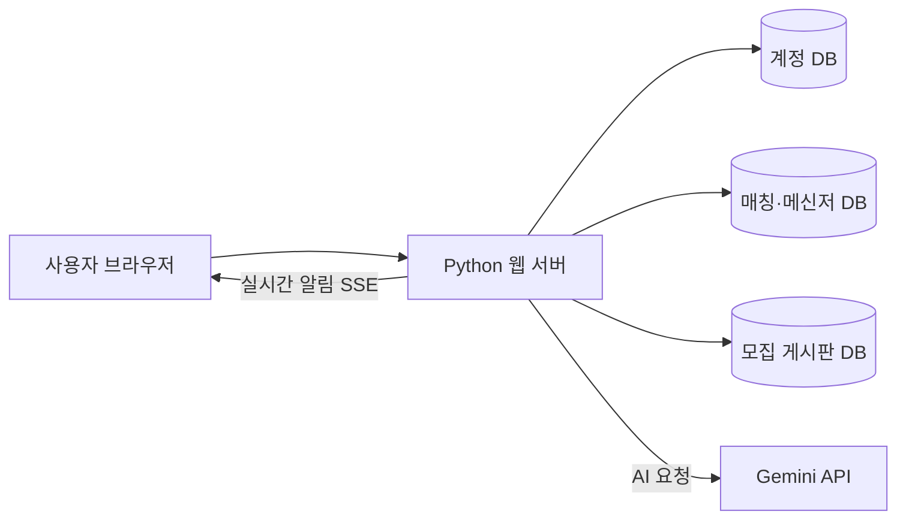

[README.md](https://github.com/user-attachments/files/34454663/README.md)
<div align="center">

# CAMPUS ONE

### AI 커리어 지원 · 팀원 매칭 · 실시간 협업을 하나로

**진로를 설계하고, 함께할 사람을 찾고, 대화까지 이어지는 캠퍼스 통합 플랫폼**


</div>

---

## 프로젝트 소개

**CAMPUS ONE**은 진로 준비와 팀 활동에 필요한 기능을 한곳에 모은 웹 기반 플랫폼입니다. AI가 전공과 희망 직무에 맞는 커리어 로드맵을 제안하고, 자기소개서·경험을 바탕으로 모의면접을 진행합니다. 팀 매칭에서는 활동 가능 시간과 역할 등을 고려하여 함께할 사람을 찾고, 매칭 수락 후에는 서비스 안에서 바로 대화를 시작할 수 있습니다.

현재 버전은 **로그인 기반의 캠퍼스 서비스 시제품**입니다. 향후 대학 구성원뿐 아니라 지역주민·방문객 등으로 이용 범위를 확장하는 방향을 고려하고 있으나, 현재 구현 기능과 운영 범위는 아래 내용을 기준으로 합니다.

## 주요 기능

| 기능 | 설명 |
| --- | --- |
| **AI 커리어 로드맵** | 전공·관심 분야·희망 직무를 바탕으로 학기별 준비 방향과 역량 개발 계획 제안 |
| **AI 모의면접** | 자기소개서·경험을 활용한 면접 질문, 후속 질문 및 피드백 제공 |
| **팀원 매칭** | 역할·협업 성향·공통 활동 가능 시간대를 기준으로 팀원 추천 |
| **매칭 신청 관리** | 신청 전송, 수락, 거절, 대기 중 신청 취소 및 재신청 대기시간 표시 |
| **실시간 메신저** | 매칭 수락 시 1:1 대화방 생성, 메시지 수신 알림 및 읽음 표시 |
| **모집 게시판** | 동아리·학회·프로젝트·공모전 등의 모집 정보 등록 및 조회 |
| **계정 관리** | 회원 가입·로그인·비밀번호 변경, 관리자 계정 관리 |

> AI 기능은 별도 **Gemini API 키**가 필요합니다. 키가 없어도 로그인, 팀 매칭의 기본 조건 검색, 신청 및 메신저 등 비AI 기능은 이용할 수 있습니다.

## 기술 구성

- **Backend:** Python 3, 표준 라이브러리 기반 HTTP 서버
- **Frontend:** HTML, CSS, JavaScript
- **Database:** SQLite (`accounts`, `members`, `activities` 분리)
- **AI:** Google Gemini API
- **Real-time:** Server-Sent Events(SSE), 보조 폴링
- **Authentication:** 세션 기반 인증, Argon2id 비밀번호 해시



## 설치 및 실행

### 1. 요구 환경

- Python 3 및 `pip`
- 최신 웹 브라우저 (Chrome, Edge 등)
- Gemini 기반 AI 기능을 사용할 경우 인터넷 연결과 개인 API 키

### 2. 프로젝트 준비

이 저장소를 클론하거나 소스코드를 다운로드하여 압축 해제합니다.

```bash
python -m pip install -r requirements.txt
```

> Windows에서는 `start_windows.bat`을 이용하면 필요한 Python 패키지를 확인하고 설치한 뒤 서버를 실행할 수 있습니다.

### 3. API 키 설정 (AI 기능 사용 시)

Gemini API 키는 저장소에 넣지 않고 **서버 환경변수**로 전달합니다.

**Windows PowerShell**

```powershell
$env:GEMINI_API_KEY = "발급받은_API_키"
.\start_windows.bat
```

**macOS / Linux**

```bash
export GEMINI_API_KEY="발급받은_API_키"
sh start_mac_linux.sh
```

키를 설정하지 않아도 서버는 실행할 수 있습니다. API 사용량 제한 및 요금은 Google의 정책을 따릅니다.

### 4. 서버 실행

**Windows**

```bat
start_windows.bat
```

**macOS / Linux**

```bash
sh start_mac_linux.sh
```

**직접 실행**

```bash
python server.py
```

기본 접속 주소:

- 서버 PC: **http://127.0.0.1:18765/**
- 동일한 사설망의 다른 PC: `http://서버_IP:18765/`
- 서버 상태 확인: **http://127.0.0.1:18765/api/health**

서버를 종료할 때는 실행 중인 터미널에서 `Ctrl+C`를 누릅니다.

### 5. 최초 관리자 생성

기본 관리자 계정이나 초기 비밀번호는 제공하지 않습니다. 서버 컴퓨터에서 아래 명령을 실행하여 직접 생성합니다.

**Windows:** `create_admin_windows.bat`  
**공통:** `python create_admin.py`

사용자 아이디는 영문·숫자 및 `._-` 조합의 3~32자, 비밀번호는 12~128자를 사용합니다.

## 기본 이용 흐름

1. **회원 가입 및 로그인:** 개인 계정을 생성하고 로그인합니다.
2. **AI 커리어 설계:** 전공·관심 분야·희망 직무를 입력하여 로드맵을 생성합니다.
3. **팀 매칭 프로필 등록:** 역할, 협업 성향, 활동 가능 시간을 입력하고 공개에 동의합니다.
4. **매칭 신청:** 추천받은 상대에게 신청합니다. 상대방은 신청을 수락하거나 거절할 수 있습니다.
5. **대화 시작:** 상대방이 수락하면 1:1 대화방이 생성됩니다. 새 메시지와 읽음 상태를 확인할 수 있습니다.
6. **면접 연습:** AI 모의면접에서 질문에 답하고 피드백을 확인합니다.

> 팀원 추천을 이용하려면 공개된 매칭 프로필이 최소 2개 필요합니다. 기존에 수락한 대화방은 매칭 참여를 중단하더라도 유지됩니다.

## 데이터 및 배포 정책

프로그램 데이터는 다음 SQLite 파일에 저장됩니다. 해당 파일들은 첫 실행 시 자동으로 생성될 수 있습니다.

| 파일 | 저장 정보 |
| --- | --- |
| `data/accounts.sqlite3` | 계정, 비밀번호 해시, 로그인 세션 |
| `data/members.sqlite3` | 매칭 프로필, 신청 내역, 1:1 대화 및 읽음 상태 |
| `data/activities.sqlite3` | 모집 게시판 글 |

**GitHub 공개 저장소에 실제 운영 DB나 비밀값을 올리지 마세요.** 제공된 `.gitignore`는 SQLite 데이터베이스, `.env` 파일, Python 캐시 등을 제외하도록 구성되어 있습니다.

- 배포용 초기화판에는 사용자 계정·세션·매칭·대화 기록이 포함되지 않습니다.
- 테스트용 API 키도 배포판에서 제거했습니다. 실제 키는 배포받은 운영자가 별도로 설정해야 합니다.
- 업데이트 전에는 서버를 중지하고 운영 DB를 백업하세요.

## 보안 및 운영 시 유의사항

- 현재 버전은 **개발·시연 및 사설망 테스트용 시제품**입니다. 공용 인터넷에 서버 포트 `18765`를 직접 노출하지 마세요.
- 로그인 세션과 권한 검사를 사용하지만, 실제 공개 서비스에는 HTTPS, 역방향 프록시, 서버 보안 설정, 백업, 운영 모니터링 등의 추가 구성이 필요합니다.
- **메신저는 종단간 암호화(E2EE)를 제공하지 않습니다.** 메시지는 서버의 SQLite DB에 저장되므로 비밀번호·민감정보를 전송하지 마세요.
- Gemini 분석 사용 시 입력한 일부 정보가 외부 AI 서비스로 전송될 수 있습니다. 개인정보 및 기밀정보 입력에 주의하세요.
- AI 로드맵·면접 피드백은 참고 자료이며 공식 학사 요건이나 실제 채용 결과를 보장하지 않습니다.

## 프로젝트 구조

```text
CAMPUS_ONE_v0.10.12/
├── server.py                 # HTTP 서버 / API
├── ai_agent.py               # Gemini AI 처리
├── ai_extended.py            # AI 확장 기능
├── auth_db.py                # 계정·인증 DB
├── member_match.py           # 팀 매칭·메신저
├── activity_db.py            # 모집 게시판 DB
├── create_admin.py           # 최초 관리자 생성
├── requirements.txt          # Python 의존성
├── start_windows.bat         # Windows 실행
├── start_mac_linux.sh        # macOS / Linux 실행
├── static/                   # 웹 프론트엔드
├── data/                     # 실행 시 생성되는 데이터
└── README.md
```

## 버전 정보

**v0.10.12** — 매칭 신청 취소 및 재신청 대기시간 표시 개선, 실시간 신청 상태 동기화, 기존 대화방 보존, 배포판의 API 키 및 사용자 데이터 초기화.

자세한 사용법과 변경 이력은 배포 패키지에 포함된 통합 사용자 설명서를 참고하세요.

---

<div align="center">

**CAMPUS ONE · AI 기반 커리어 및 협업 플랫폼**

</div>
